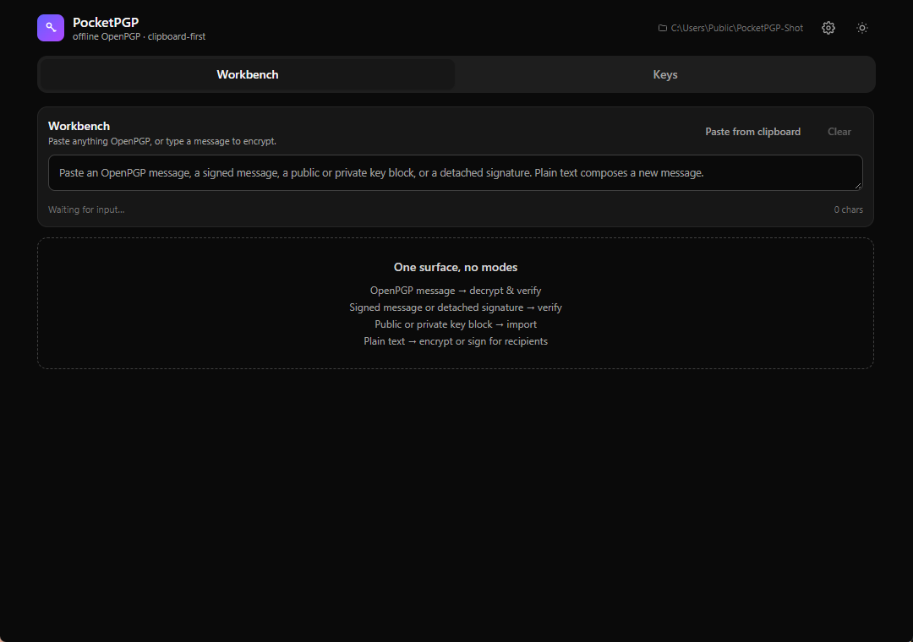
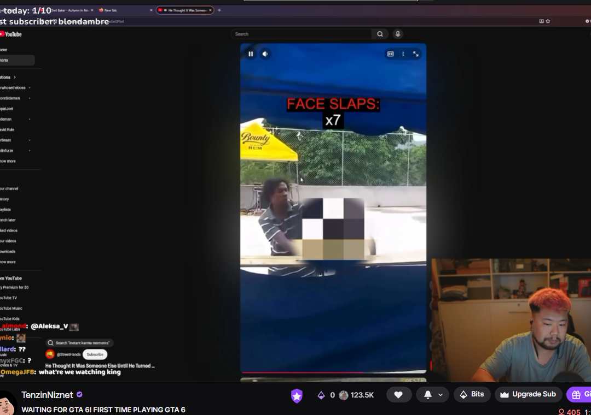

# PocketPGP

[](https://github.com/trinlol/PocketPGP/actions/workflows/ci.yml)
[](https://github.com/trinlol/PocketPGP/releases)

A minimal, modern, fully-offline OpenPGP app for Windows — a clipboard-first
alternative to Kleopatra, without the UI bloat.

| Workbench — one paste surface, auto-detects | Keys — your keyring at a glance |
|---|---|
|  |  |

Everything you need for personal daily OpenPGP use, nothing else:

- **Workbench** — one paste surface that auto-detects what you pasted:
  an OpenPGP message (→ decrypt & verify), a signed message (→ verify),
  a public/private key block (→ import), or plain text (→ compose, pick
  recipients, encrypt & copy). Whitespace-mangled armor from chat apps still
  parses.
- **Keys** — a flat, searchable list of your keyring. Generate keys
  (Ed25519/X25519 by default, RSA-3072/4096 under Advanced), always with a
  chosen expiry; copy public/private to the clipboard in one click; change
  passphrases, extend expiry, and generate revocation certificates.
- **100 % offline.** No keyserver, no WKD, no update checks, no network
  calls of any kind. Keys enter your keyring only by paste/import.
- **Private keys are passphrase-encrypted at rest.** No plaintext secret
  ever touches disk; passphrases live in memory only for the single
  operation that needs them.

## Install

**Windows 10/11** — grab the latest release from the
[releases page](https://github.com/trinlol/PocketPGP/releases):

- **`PocketPGP_0.1.0_x64-setup.exe`** — the installer (per-user, no admin
  prompt). Adds Start-menu entries and an uninstaller.
- **`pocketpgp.exe`** — the portable build. One file, no install; put it
  anywhere and run it. Requires the WebView2 Runtime (preinstalled on
  current Windows 10/11).

Both are fully offline: the app makes no network calls, ever.

## Using it

```
npm install            # once
npm run tauri dev      # run the app in development
```

Build the portable executable:

```
npm run tauri build -- --no-bundle
# → src-tauri/target/release/pocketpgp.exe  (portable, needs WebView2 Runtime)
```

The exe is self-contained apart from the WebView2 Runtime, which is
preinstalled on Windows 10/11 and downloadable from Microsoft.

### Where keys live

```
%LOCALAPPDATA%\PocketPGP\
  keys\<FPR>.pub.asc    armored public key (exactly what you paste into an email)
  keys\<FPR>.sec.asc    passphrase-encrypted armored secret key
  keys\<FPR>.rev.asc    revocation certificate
  index.json           rebuildable cache (never source of truth)
  settings.json        theme, clipboard auto-clear, default profile
```

One armored file per key: a corrupt file loses exactly one key, and backing
up is a file copy. The directory is inside your per-user profile directory;
its ACL is verified at startup and a persistent warning is shown if other
users can read it.

## Interoperability profiles

2026 reality: stock Kleopatra/GnuPG/Thunderbird speak LibrePGP (v4) and
cannot read RFC 9580 v6 keys (GnuPG needs ≥ 2.5.23 **plus** the
`--allow-9980` option). PocketPGP therefore defaults to the profile that
works everywhere:

| Profile | Default? | Key format | Protection | Interoperates with |
|---|---|---|---|---|
| **Compatible** | ✔ | v4 — Ed25519/X25519 (legacy IDs) or RSA-3072/4096 | iterated+salted S2K (SHA-256, AES-256), no AEAD, no compression | Kleopatra/GnuPG 2.4+, Thunderbird, Mailvelope, mobile clients |
| **RFC 9580** | opt-in, marked experimental | v6 keys | AEAD (OCB), Argon2 S2K | modern libs only |

The profile is chosen per operation (Advanced panel) and derived per key;
PocketPGP refuses to emit RFC 9580 ciphertext to v4 recipients and explains
why, and warns when v6 recipients appear in a Compatible context.

### Interop test matrix

`tests/interop.ps1` drives the app's real Rust core (via the
`interop-cli` harness binary) against stock GnuPG. All 14 cases pass
against GnuPG 2.5.24 — key imports in both directions (ECC, RSA-4096,
passphrase-protected secret files, `gpg --export-secret-keys`), sign+encrypt
round-trips, clearsign, detached signatures, old RSA keys, bumped subkey
expiry, revoked-key encrypt blocking, oversized/garbled paste rejection,
and whitespace-mangled armor. Run it with:

```
powershell -File tests\interop.ps1
```

## Security notes

- **Single engine:** rPGP 0.21 (native Rust). No JS crypto, no Argon2-WASM,
  no `wasm-unsafe-eval` in the CSP.
- **Decrypt-then-verify, always.** Verification outcomes show the signer's
  fingerprint and key source (*own key / imported / unknown*) — no invented
  trust model, no bare green checkmarks. A `write_secret` hint keeps
  ciphertext, keys and decrypted text out of the Windows clipboard history
  (Win+V) and cloud sync; the clipboard auto-clears (default 60 s,
  configurable) and is only ever read when you click "Paste from clipboard".
- **Private key material never crosses the app boundary.** Copying a
  private key reads and clips the armored file entirely inside Rust; the UI
  only ever sees public keys, metadata, results, and verification outcomes.
- **Hard rejects with clear messages:** DSA/Elgamal keys, secp256k1, v2/v3
  keys, and keys missing key-flag subpackets (the last one can be allowed
  via the legacy override under Advanced).
- **Paste size cap** of ~1 MB; untrusted text is validated before it is
  ever rendered.
- **Atomic writes** (temp file + rename, one `.bak` kept) so a crash can
  corrupt at most one file, never the whole keyring.

## Known limitations (v1)

- No symmetric/password-only encryption, no smartcards/YubiKey, no
  X.509/S-MIME, no web-of-trust UI, no file/archive encryption.
- No keyserver or WKD lookups — keys arrive by paste or import.
- "Binary" output is presented base64-wrapped for clipboard transport;
  clipboard-first means armor is the native format.
- No "remember passphrase" — every passphrase-using operation prompts
  (in-app modal, never an external pinentry window).
- v6/RFC 9580 is behind a clearly labeled experimental opt-in; the wider
  ecosystem is still catching up.

## Development notes

- Frontend: Vite + TypeScript + React + Tailwind 4, hand-rolled components.
  `npm run dev` serves the UI in a plain browser with a mock backend
  (`src/mock.ts`) so every flow can be exercised without Tauri.
- Backend: Rust (`src-tauri/`), modules: `keygen` (both profiles, expiry
  re-signing, revocation certs), `msgops` (encrypt/decrypt/sign/verify with
  decrypt-then-verify), `store` (the `%LOCALAPPDATA%` keyring), `armorfix`
  (whitespace-tolerant armor), `commands` (the Tauri command layer).
- `cargo test --lib` covers keygen round-trips, at-rest encryption of every
  secret packet, armor mangling, and a sign+encrypt → decrypt+verify
  round-trip.
- `POCKETPGP_DATA_DIR` overrides the key store location (used by the
  interop harness and tests to isolate state; your real keys live in
  `%LOCALAPPDATA%\PocketPGP`, which Windows cleanup never touches).
- CI runs the full test suite on every push; pushing a `v*` tag builds both
  release artifacts on GitHub's runners and attaches them to the release
  automatically (`.github/workflows/release.yml`).

## License

MIT OR Apache-2.0 (matching rPGP and the Tauri stack).
